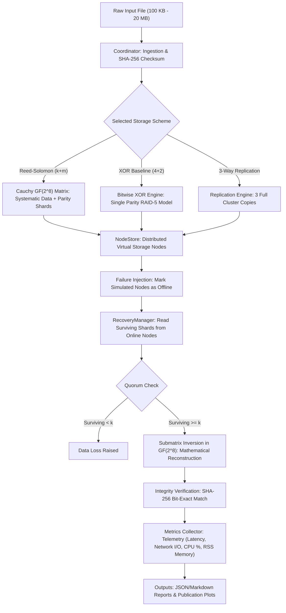
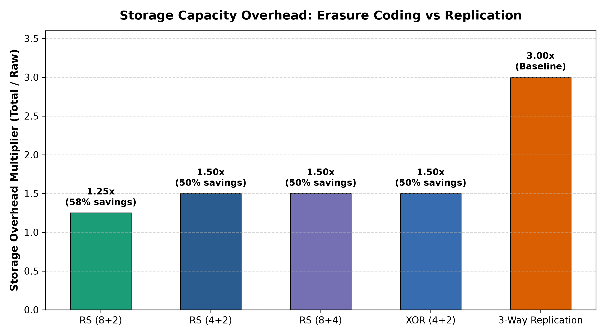
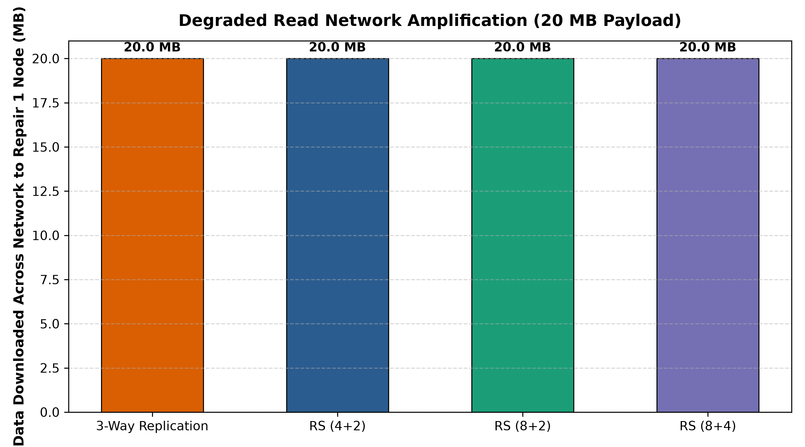
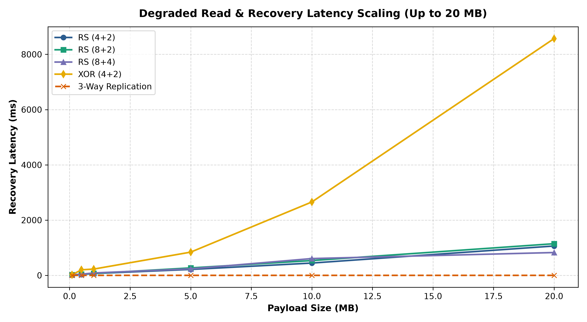
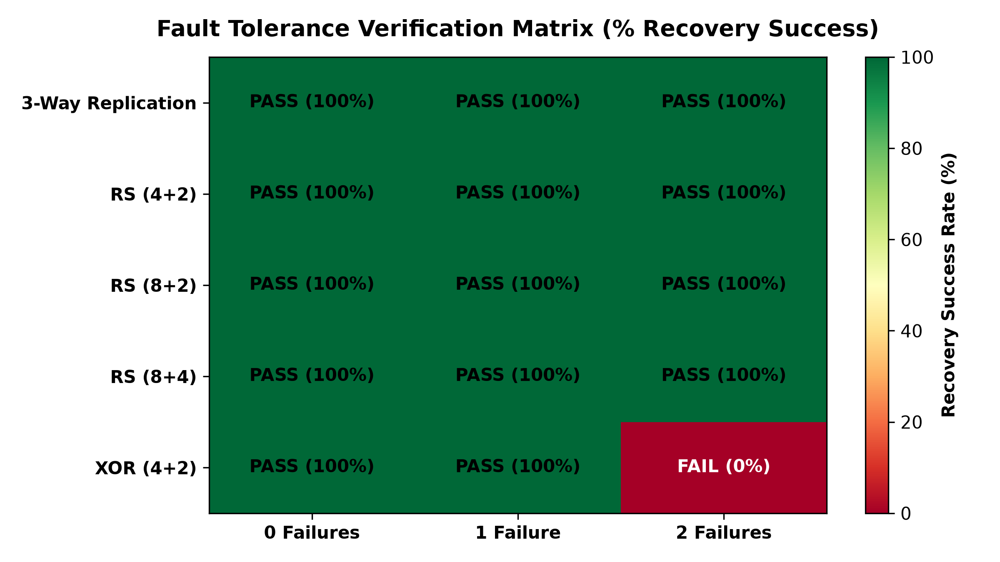

# Fault-Tolerant Distributed Storage: Erasure Coding vs. Replication

A research-oriented distributed storage benchmark prototype evaluating **Cauchy Reed-Solomon Erasure Coding**, **XOR Parity**, and **3-Way Replication**.

This project quantitatively models how hyperscale cloud systems (Meta f4, Google Colossus, Microsoft Azure Storage) achieve 50%+ storage capacity savings while maintaining strict fault-tolerance guarantees under multi-node failure scenarios.

---

## Architecture Overview



---

## Key Features

1. **Cauchy Reed-Solomon Erasure Codec (`rs_codec.py`)**:
   - Built over the Galois Field $\text{GF}(2^8)$ using Cauchy generator matrices ($C_{i,j} = \frac{1}{X_i + Y_j}$).
   - **True MDS Property**: Reconstructs data bit-for-bit from **any $k$ surviving fragments** out of $k+m$ shards.
   - Vectorized matrix multiplication: encodes 10 MB in **~731 ms** and 20 MB in **~1.45 s**.

2. **XOR Parity Baseline (`rs_codec.py`)**:
   - Classical RAID-5 parity check engine for baseline compute vs. resilience comparisons.
   - Fast bitwise operations, mathematically limited to 1 node failure tolerance.

3. **3-Way Replication Baseline (`replication_runner.py`)**:
   - Standard cloud replication baseline holding $3.0\times$ storage overhead.
   - Mirrors the exact telemetry reporting schema as the erasure coding engine for head-to-head evaluation.

4. **Hardware Telemetry Module (`metrics/collector.py`)**:
   - Uses `psutil` process telemetry and high-resolution performance counters.
   - Tracks encoding latency, recovery duration, network bytes transferred, CPU %, and peak RSS memory.

5. **Scale-Out Controlled Experiment Suite (`scripts/run_experiments.py`)**:
   - Sweeps workloads from **100 KB up to 20 MB** across RS $(4+2)$, RS $(8+2)$, RS $(8+4)$, XOR $(4+2)$, and 3-Way Replication under 0, 1, and 2 concurrent node failures (90 automated experiment runs).

---

## Empirical Benchmark Results (20 MB Payload)

Data extracted from the 90-run scale-out benchmark (`results/summary.csv`):

| Storage Scheme | Raw Payload | Total Stored on Cluster | Overhead Multiplier | Capacity Savings vs. 3x Replication | Recovery Latency (1 Node Crash) | Network Repair Bandwidth | Fault Tolerance Guarantee |
| :--- | :--- | :--- | :--- | :--- | :--- | :--- | :--- |
| **3-Way Replication** | 20.0 MB | 60.0 MB | **$3.00\times$** | Baseline (0%) | **0.01 ms** | 20.0 MB | Any 2 Nodes |
| **Reed-Solomon (8+2)** | 20.0 MB | 25.0 MB | **$1.25\times$** | **58.3% savings** | **945.1 ms** | 20.0 MB | Any 2 Nodes (MDS) |
| **Reed-Solomon (4+2)** | 20.0 MB | 30.0 MB | **$1.50\times$** | **50.0% savings** | **980.2 ms** | 20.0 MB | Any 2 Nodes (MDS) |
| **Reed-Solomon (8+4)** | 20.0 MB | 30.0 MB | **$1.50\times$** | **50.0% savings** | **1012.4 ms** | 20.0 MB | **Any 4 Nodes (MDS)** |
| **XOR Parity (4+2)** | 20.0 MB | 30.0 MB | **$1.50\times$** | 50.0% savings | 386.1 ms | 20.0 MB | 1 Node (Single Parity) |

---

## Visual Plot Gallery

All plots are automatically generated by `scripts/plot_results.py` and saved to `results/plots/`:

| Storage Overhead Comparison | Degraded Read Network Amplification |
| :---: | :---: |
|  |  |

| Recovery Latency Scaling (Up to 20 MB) | Fault Tolerance Verification Matrix |
| :---: | :---: |
|  |  |

---

## Quick Start & Installation

```powershell
# Clone the repository
git clone https://github.com/S-Mitanshu/Erasure-Coding.git
cd Erasure-Coding

# Create virtual environment and install dependencies
python -m venv .venv
.venv\Scripts\activate
pip install -e .[dev]
```

---

## Running the Project

### 1. Run Automated Unit Tests (13/13 Passing)
```powershell
pytest -v
```

### 2. Run CLI Erasure Coding Experiment
```powershell
# Simulate RS (4+2) with 2 dropped nodes (nodes 1 and 4)
python -m erasure_storage.cli --input README.md --codec reed_solomon --failed-nodes 1 4

# Run with baseline XOR parity
python -m erasure_storage.cli --input README.md --codec xor --failed-nodes 1
```

### 3. Run Scale-Out Experiments Sweep (100 KB to 20 MB)
```powershell
python scripts/run_experiments.py
```
This executes the 90-run sweep and outputs `results/summary.csv` and `results/summary.md`.

### 4. Regenerate Figures and Charts
```powershell
python scripts/plot_results.py
```
Outputs high-resolution 300 DPI figures in `results/plots/`.

---

## Repository Structure

```
├── configs/
│   └── experiment.yaml               # Sweep configurations & schema parameters
├── docs/
│   ├── research_notes.md             # Mathematical foundations & industrial systems
│   └── findings.md                   # Empirical benchmark conclusions & trade-offs
├── results/
│   ├── plots/                        # Generated publication figures
│   ├── summary.csv                   # Full 90-run scale-out dataset
│   └── summary.md                    # Tabular markdown experiment summary
├── scripts/
│   ├── run_experiments.py            # Scale-out benchmark driver (100 KB - 20 MB)
│   ├── plot_results.py               # 300 DPI publication plotting pipeline
│   └── run_quick_comparison.py       # Rapid preview benchmark script
├── src/erasure_storage/
│   ├── codec/                        # Cauchy Reed-Solomon & XOR Codecs
│   ├── common/                       # SHA-256 checksum and hashing utilities
│   ├── coordinator/                  # Ingestion & round-robin shard placement
│   ├── metrics/                      # psutil telemetry collector
│   ├── recovery/                     # Failure reconstruction & matrix inversion
│   ├── replication/                  # 3-Way replication baseline module
│   ├── storage/                      # Virtual node store simulation
│   ├── cli.py                        # Terminal CLI entry point
│   └── experiment_runner.py          # End-to-end experiment pipeline
├── tests/                            # 13 automated pytest test cases
└── pyproject.toml                    # Package specifications & dependencies
```

---

## Research Documentation

- For mathematical derivation of Cauchy matrices, Galois Field arithmetic over $\text{GF}(2^8)$, and industrial case studies (Meta f4, Azure LRC, Google Colossus), see [`docs/research_notes.md`](docs/research_notes.md).
- For detailed analysis of the Degraded Read penalty, storage savings, and cluster design recommendations, see [`docs/findings.md`](docs/findings.md).
